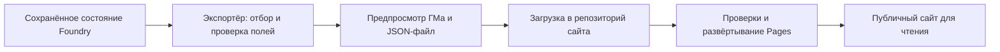

# Публичный сайт состояния Skyhold: план реализации

Дата: 2026-10-09. Статус: проект решения; реализация и публикация не выполнены.

Пользователь выбрал открытый сайт: опубликованные сведения доступны любому посетителю без входа. Все игровые действия и единственное авторитетное состояние остаются в Foundry. Сайт показывает последнее опубликованное состояние, даже когда Foundry выключен.

## 1. Предлагаемое решение

Первая версия: статический сайт на GitHub Pages и один JSON-файл с подготовленными публичными данными. Supabase, аккаунты игроков и сервер игровых правил не требуются.

Экспорт и публикация — разные действия. Экспорт создаёт локальный файл; он ещё не обновляет сайт. В первой версии ГМ вручную загружает проверенный файл в репозиторий сайта. GitHub Actions проверяет данные и развёртывает сайт. После успешного развёртывания посетители получают новую версию.

Это осознанное ограничение первой версии: убрать ручную загрузку можно позднее, сохранив формат снимка и интерфейс сайта. Автоматическое получение уже опубликованных данных браузером не означает автоматическую публикацию из Foundry.

## 2. Что подтверждено в текущем коде

| Точка | Значение для реализации |
| --- | --- |
| `scripts/data/store.js`, `SkyholdData.view()` | Есть согласованное представление данных для чтения; экспорт не должен вызывать транзакции или сохранять нормализацию. |
| `scripts/data/split-storage.js` | Сохранение разделено на meta/holdings/catalog и имеет маркер завершённого коммита. Снимок нельзя собирать из независимо прочитанных частей во время записи. |
| `scripts/data/access-guard.js` | Есть фильтрация владений по `visibility`; при экспорте от лица ГМа нужна явно заданная аудитория игрока. Обычный вызов с текущим GM пропустит скрытые владения. |
| `scripts/data/notifications.js`, `scripts/main.js` | `fblSkyholdDataChanged` — сигнал обновления, который получают разные клиенты; сам по себе он не является разрешением или доказательством завершённого коммита. |
| `scripts/data/authority.js`, `scripts/data/gm-write-authority.js` | Уже выбран ответственный GM. Для будущей автоматической публикации следует использовать того же ответственного клиента. |
| `scripts/apps/skyhold-app.js`, `_prepareActiveTabContext()` | Часть показателей рассчитывается только для активной вкладки. Копирование render context даст неполный снимок. |
| `scripts/data/schema/base-holding.js` | В `gm` находятся как секреты, так и используемые игроками показатели. Нужен явный отбор полей. |
| `scripts/engines/tenday/operation-payload.js` и применение десятника | Сохраняется компактный отчёт в записи операции. Возможны усечённые строки; экспорт обязан сохранить указание неполноты. |
| `scripts/dev/package.mjs` | Пакет модуля использует список разрешённых runtime-каталогов. Будущий `web/` следует оставить вне архива Foundry; сам packaging сейчас не запускать. |

Это точечная оценка перечисленных участков. Полный перечень публичных полей будет проверяться при реализации каждого раздела.

## 3. Структура сайта

Один сайт может показывать несколько явно выбранных владений. Вверху: название кампании, выбор владения, игровой период, время формирования снимка и кнопка повторного чтения опубликованных данных.

| Раздел | Содержимое | Этап |
| --- | --- | --- |
| Обзор | Название, публичное описание, население, мораль, репутация, развитие, казна и опубликованные предупреждения | Первая версия |
| Жители / экипаж | Список, профессии, назначения, доступные характеристики, состояние; поиск и фильтры | Первая версия |
| Здания / узлы корабля | Построенные объекты, состояние, работники, прогресс строительства, текущие производственные линии | Первая версия |
| Склад / груз | Ресурсы, количество, единицы измерения, помещения и вместимость; поиск и сортировка | Первая версия |
| Последний десятник | Разрешённые итоги последнего применённого периода: приход, расход, стройки; отметка об усечённых данных | Первая версия |
| Финансы | Опубликованные обязательства, расходы, доходы; прогнозы с явной подписью, если их источник проверен | Расширение |
| Оборона | Итоговые показатели и разрешённый состав отрядов | Расширение |
| Корабли и торговля | Состояние кораблей, текущие рейсы, грузы, опубликованные заказы | Расширение |
| Особое / политика | Только явно разрешённые записи и действующие эффекты | Расширение |
| История | Ограниченная очищенная история известных игрокам изменений | Расширение |

Карточки жителей и зданий открываются внутри сайта. Переходы могут сохраняться в URL через hash, например `#/holding/<id>/people`, чтобы не требовалась серверная маршрутизация GitHub Pages.

Поиск, раскрытие деталей и сортировка работают локально. Сайт не проводит десятник, не бросает кубики, не назначает работников, не торгует и не записывает Foundry world settings.

## 4. Публичный контракт данных

Ввести отдельный контракт `PublicSnapshotV1`; он не заменяет формат хранения мира. Экспортёр создаёт новый объект из разрешённых скалярных полей и явно описанных вложенных структур. Не копировать целиком `holding`, `gm`, `catalog`, `payload`, произвольные `notes` или render context.

Служебная часть снимка:

| Поле | Назначение |
| --- | --- |
| `schemaVersion` | Версия публичного формата; первоначально 1 |
| `projectionVersion` | Версия правил отбора и представления данных |
| `sourceModuleVersion` | Версия модуля для диагностики |
| `snapshotId` | Идентификатор конкретного снимка |
| `sourceRevision` | Ревизия состояния Foundry, из которого получены данные |
| `generatedAt` | Время формирования в UTC; сайт форматирует для посетителя |
| `campaignTitle` | Явно заданное публичное название кампании |
| `holdings` | Только выбранные и разрешённые владения |

Каждое владение содержит собственные DTO разделов: `overview`, `residents`, `buildings`, `storage`, `lastTenday`. Отключённый или недоступный раздел имеет явный статус; отсутствие данных не выдаётся за нулевые значения.

Суммы хранить в целых медных монетах, количества — вместе с единицами, даты — в однозначном формате. Идентификаторы владений и записей нужны для навигации и связей внутри снимка. Foundry UUID актёров, идентификаторы пользователей, адрес сервера и локальные пути не публиковать.

В DTO достаточно включать используемые названия ресурсов, единицы и подписи. Полный каталог зданий, регионов, случайных событий и крупные content packs сайту не нужны.

Числовые итоги готовятся экспортёром на стороне Foundry с использованием существующих чистых расчётов. Если расчёт доступен только как метод домена, сначала выделить минимальную функцию без UI-зависимостей, с проверкой совпадения результатов. Сайт форматирует полученные значения и не дублирует игровые формулы.

Последний отчёт брать из применённой операции `type: tenday`, а не из открытого preview и не через повторный запуск симуляции. Если старый отчёт отсутствует или частично сохранён, показать это. Из отчёта выделять разрешённые показатели; будущие события и необработанный payload не публиковать.

## 5. Правила отбора публичных сведений

1. ГМ выбирает владения для публикации. Владения `visibility: gm` исключаются независимо от выбранного списка. Отдельный web-export не должен расширять игровую видимость.
2. Записи со своей видимостью проверяются отдельно: доступное владение может содержать скрытую запись. Ссылки на исключённые сущности также удаляются или заменяются нейтральной подписью.
3. В первой версии свободные заметки исключены по умолчанию. Публичное описание и `publicNotes` включаются только при выборе соответствующей категории в предпросмотре.
4. Скрытые заметки, будущие события, таблицы случайных событий, служебные настройки и полный журнал не входят в публичный контракт.
5. Обычные показатели из `gm`, например известный игрокам итог обороны, переносить в публичный DTO поштучно. Не передавать пояснения, раскрывающие скрытые модификаторы.
6. Незнакомые поля и новые разделы не появляются на сайте автоматически после обновления модуля. Схема валидатора запрещает неожиданные вложенные ключи.
7. Строки отображаются как текст. HTML, Foundry enrichers, UUID-ссылки и обработчики событий из данных не исполняются. Для первой версии достаточно plain text.
8. Предпросмотр показывает ровно тот JSON, который будет выгружен, и человекочитаемое представление его содержимого. Это позволяет заметить сюжетные сведения в формально разрешённом тексте.

Техническая фильтрация не способна определить все сюжетные секреты в именах и описаниях. Для открытого сайта первичный просмотр ГМом остаётся частью публикации. Публичный файл доступен напрямую, даже если его поле не отображается на странице; публикация в Git сохраняет старые версии в истории.

## 6. Экспорт в Foundry

Добавить GM-only действие «Экспорт для сайта» в существующую подходящую группу инструментов. Оно открывает небольшое Application V2 окно с выбором владений, разделов, публичного названия и предпросмотром. Игрок не видит действие и не может выполнить его через прямой вызов обработчика.

Первая версия не сохраняет профиль экспорта в данных владения. Выбор можно хранить в памяти окна; постоянные клиентские настройки профиля — отдельное согласованное дополнение. Это позволяет обойтись без изменения текущего storage contract.

Порядок выполнения:

1. Проверить GM-права в точке входа.
2. Проверить состояние commit marker. При незавершённом сохранении предложить повтор после его окончания. Для старого формата без подтверждаемого согласованного коммита экспорт не должен автоматически мигрировать или записывать мир.
3. Получить один согласованный `SkyholdData.view()` и зафиксировать его ревизию. Не читать три настройки независимо на протяжении экспорта.
4. Сформировать публичную проекцию без изменения источника. Дорогие зависимости загружать только при открытии экспорта или выборе соответствующего раздела.
5. Проверить снимок общей схемой и показать предпросмотр. Если мир изменился за время подготовки, отметить устаревший предпросмотр и предложить пересборку; не подменять данные под уже просмотренным результатом.
6. По кнопке скачать JSON. Статус: «Файл экспортирован», а не «Сайт обновлён».

Ошибка экспорта никак не влияет на игровое сохранение. Публичный экспорт не вызывает `SkyholdData.set()`, транзакции, `settings.set()`, обновления Actors/Items или проведение периода.

Новый экспортёр не импортировать через тяжёлые окна в startup graph. Учитывать текущие адаптеры Foundry 13/14 и сохранять состояние открытого менеджера и фокус.

## 7. Интерфейс сайта и изображения

Первую версию можно написать на HTML, CSS и JavaScript ES modules без новых production dependencies. Данные загружаются через отдельный `snapshot-source`, что позволит позже заменить статический URL на read-only API.

Структура страницы: общий заголовок, компактная сводка, навигация по разделам, таблицы/карточки, подробности выбранной записи. На узком экране крупные таблицы получают удобную прокрутку или карточное представление. Клавиатура, подписи кнопок и состояния загрузки входят в критерии готовности.

Сохранить знакомые названия и визуальные токены модуля. Не переносить весь Foundry CSS и не зависеть от глобальных стилей Foundry. Владение стилями и возможный перенос токенов уточнить по `styles/README.md` перед визуальной реализацией; использовать семантические токены, не добавлять `!important`.

В первом прототипе использовать нейтральные локальные значки и заглушки. Изображения из `worlds/...`, `modules/...` и локального адреса Foundry не станут доступны на другом домене сами. Их перенос — отдельный этап: явно выбранные публичные файлы, допустимые пути, проверка формата/размера и ссылки относительно сайта. Не копировать весь каталог assets или содержимое платных паков автоматически.

Загрузка: читать JSON, проверять схему, только после успешной проверки заменять отображаемый снимок целиком. При ошибке оставлять последнюю успешно загруженную версию в текущей вкладке и показывать ошибку обновления. При первой загрузке без доступного снимка показывать понятное пустое состояние.

В первой версии достаточно чтения при открытии страницы и кнопки «Проверить обновление». Периодическая проверка в видимой вкладке может появиться позже. На панели различать «Снимок сформирован» и «Проверено на сайте»; сайт не знает о неопубликованных изменениях в выключенном Foundry.

## 8. Размещение и ручное обновление

Предлагается отдельный репозиторий публикации, содержащий только сайт, публичный снимок и разрешённые изображения. Это не требует открывать весь репозиторий модуля, мир Foundry или используемые content packs.

Рабочий процесс владельца:

1. Завершить изменения в Foundry, открыть экспорт и проверить предпросмотр.
2. Скачать снимок.
3. Через GitHub загрузить его с заменой `data/skyhold.json` в репозитории сайта и сохранить изменение.
4. Дождаться успешной проверки и развёртывания GitHub Pages.
5. Открыть сайт и сверить `snapshotId`, состав владений и время формирования.

Workflow проверяет публичную схему, ссылки и размер снимка, затем публикует только разрешённый статический каталог. Не загружать корень репозитория модулей как Pages artifact. Настроить упорядочивание развёртываний и защиту от публикации устаревшего commit поверх нового.

Ошибка валидации или сборки не должна заменять исправно опубликованную версию. Сайт и снимок поставляются совместимо: поддержка версии схемы проверяется до показа, несовместимость не превращается в частично пустые таблицы. Пути должны работать и на `/repository-name/`, а не только в корне домена.

Развёртывание занимает отдельное время; не обещать мгновенного обновления после скачивания файла или загрузки на GitHub. На первоначальную публикацию и загрузку реальных данных этот план разрешения не даёт.

## 9. Как добавить публикацию без ручной загрузки

Это самостоятельный этап после готовности экспортёра и просмотра. Существуют два пути; первоначальная версия не зависит от выбора.

**Локальная утилита публикации.** Принимает уже проверенный публичный JSON, валидирует и обновляет только файл данных в репозитории сайта через аутентифицированный GitHub CLI/API. Доступ хранится в окружении владельца, а не в общем world setting и не в JavaScript сайта. Это сокращает ручные шаги, но не превращает GitHub Pages в сервер приёма данных.

**Публикация непосредственно из Foundry.** Если нужна кнопка «Опубликовать» без отдельной утилиты и дальнейший автоматический режим, добавить узкий HTTPS endpoint, например на Supabase. Он принимает только публичный снимок от разрешённого издателя. Посетители имеют только чтение опубликованного состояния; ключи серверного администратора в Foundry и на сайт не передаются. Авторизация издателя, отзыв доступа, CORS и атомарная замена последнего снимка проектируются и проверяются отдельно перед реализацией этого этапа.

Для автоматического режима потребуется:

- Явное включение ГМом, закреплённый состав владений/разделов и один ответственный клиент.
- Планирование публикации после успешного завершённого сохранения; `fblSkyholdDataChanged` можно использовать лишь как сигнал повторной проверки состояния.
- Объединение серии изменений, ограничение частоты и одна выполняющаяся публикация.
- Повтор того же `snapshotId` после сетевой ошибки; одинаковый снимок не создаёт новое действие.
- Защита сервера от опоздавшего запроса, заменяющего новый снимок старым; проверка поколения источника и ревизии. Восстановление мира из старой резервной копии обрабатывается явно, а не слепым сравнением времени на компьютере ГМа.
- Продолжение игры при недоступности сервиса, с понятным статусом публикации и возможностью повторить позднее.
- При закрытых клиентах ГМа остаётся последний опубликованный снимок; это не ошибка сайта.

Supabase при таком расширении хранит только публичное представление, а не становится второй базой игрового мира. Пересборка интерфейса при каждом изменении данных уже не нужна.

## 10. Предлагаемое размещение кода

Ниже будущие пути, а не уже созданные файлы. Директории можно уточнить при реализации в пределах тех же обязанностей.

| Путь | Ответственность |
| --- | --- |
| `scripts/data/public-view/contract.js` | Версии и строгая проверка публичного DTO, без Foundry globals |
| `scripts/data/public-view/projection.js` | Явный отбор владений, полей и связей |
| `scripts/data/public-view/sections/` | Маленькие сборщики overview/residents/buildings/storage/report |
| `scripts/workflows/public-view/export.js` | Подготовка снимка из согласованного view, ревизия и результаты проверки |
| `scripts/apps/public-view-export-app.js` | GM-only Application V2 с настройками и предпросмотром |
| `templates/public-view-export.hbs` | Разметка окна экспорта |
| `scripts/main.js` и текущая группа действий | Небольшая точка ленивого открытия окна |
| `web/index.html`, `web/src/`, `web/styles/` | Независимый интерфейс просмотра |
| `web/src/snapshot-source.js` | Загрузка статического снимка; позднее возможен API |
| `web/data/skyhold.json` | На этапе разработки только искусственный пример без данных мира |
| `scripts/dev/public-view-characterization-check.mjs` | Контракты отбора, вычислений и отсутствия записи |
| `scripts/dev/public-view-site-check.mjs` | Контракт сайта, артефакта публикации и путей |

При сборке сайта копировать общий публичный валидатор с явным списком разрешённых зависимостей. Не втягивать data defaults, полный каталог, Foundry window classes или весь модуль через удобный barrel import.

## 11. Этапы и критерии готовности

| Этап | Работа | Проверяемый результат |
| --- | --- | --- |
| 1. Контракт | Матрица публичных полей первых пяти разделов, пример на искусственных данных, версия формата | Можно точно перечислить всё, что уйдёт в интернет; неизвестные поля отклоняются |
| 2. Экспортёр | Чистая проекция, расчёт показателей, валидатор, очищенный отчёт | Источник не меняется, скрытые сведения отсутствуют, известные показатели совпадают с Foundry-расчётами |
| 3. Окно Foundry | GM-only открытие, выбор владений, предпросмотр, выгрузка | Получается валидный файл; игрок не может вызвать экспортёр, запись мира не выполняется |
| 4. Просмотр | Пять разделов, навигация, поиск, адаптация к экрану, ошибки загрузки | Сайт работает без Foundry globals и показывает всё содержимое DTO |
| 5. Поставка | Отдельный репозиторий сайта, проверки, Pages workflow и инструкция | На демонстрационном снимке проверена публикация; артефакт не содержит посторонних файлов |
| 6. Первая реальная публикация | Пользовательская проверка публичного снимка, отдельное разрешение на размещение, сверка сайта | Подтверждённое состояние доступно при выключенном Foundry |
| 7. Расширения | Остальные разделы и изображения по одному | Каждый раздел имеет свой публичный контракт и проверки |
| 8. Удобная публикация | Локальная утилита либо сервис приёма, затем опциональная автоматика | Не требуется вручную загружать файл; ошибки не мешают игре и не откатывают сайт на старый снимок |

Первый полезный рубеж — этапы 1–5 на искусственных данных. Первая рабочая версия для группы — этап 6. Не оценивать перенос всех оставшихся вкладок как одну небольшую задачу: их объём зависит от скрытых данных и связей с Actors/Items.

## 12. Проверки будущей реализации

Фокусированные Node-проверки: публичные и скрытые владения; выбор аудитории при текущем GM; скрытые вложенные записи; секретные метки в `gm.notes`, будущих событиях и свободных заметках; недопустимые поля/URL/HTML; отсутствие исходных Actor UUID; сохранение выбранных идентификаторов и связей; денежные единицы; отсутствие отчёта; усечённый отчёт; пустое поселение; несовместимая схема; незавершённый commit; изменение ревизии во время предпросмотра. Заморозить входные данные и подставить бросающие ошибку write API, чтобы поймать случайные записи.

Для вычисляемых показателей — сравнение с существующими проверенными engine-функциями на небольших независимых сценариях. Не создавать ожидания простым копированием текущего результата экспортёра.

По затронутым частям запускать: `npm run suite:data`, `npm run ui:check`, `npm run compat:check`, `npm run lazy:check`, `npm run lint`. После CSS — `npm run css:check`. Если затронут storage/authority, дополнительно `npm run suite:storage`; предпочтительно вовсе не менять их запись. Производительность измерять при выявленных тяжёлых расчётах или увеличении startup graph. Packaging не нужен до запроса архива.

Ручная проверка в Foundry принадлежит пользователю, если он отдельно не делегирует её: GM создаёт экспорт и сверяет цифры; игрок не получает управление экспортом; секреты отсутствуют в самом JSON; окно не сбрасывает фокус/вкладки; повтор при изменённом мире даёт новый согласованный снимок; работа проверена в целевой v13 и сохранена совместимость v14.

Браузерная проверка сайта: desktop и узкий экран; клавиатура; прямые ссылки; размещение в подпапке; первый запуск без данных; повреждённый/неподдерживаемый JSON; обновление без потери выбранного раздела; повторное чтение после нового deploy; Foundry выключен; прямой URL JSON содержит только публичные данные.

## 13. Результат текущего этапа

Создан только этот план. Runtime, зависимости, формат хранения и данные мира не менялись. Экспорт, автоматическая публикация, GitHub-репозиторий и Supabase не создавались. Проверки реализации перечислены как будущие; их прохождение этим документом не заявляется.

## Официальные источники

- [GitHub Pages — статический HTML/CSS/JavaScript-хостинг](https://docs.github.com/en/pages/getting-started-with-github-pages/what-is-github-pages).
- [Загрузка файлов через веб-интерфейс GitHub](https://docs.github.com/en/repositories/working-with-files/managing-files/adding-a-file-to-a-repository).
- [Развёртывание Pages через GitHub Actions](https://docs.github.com/en/pages/getting-started-with-github-pages/using-custom-workflows-with-github-pages).
- [Ограничения GitHub Pages](https://docs.github.com/en/pages/getting-started-with-github-pages/github-pages-limits).
- [Supabase Edge Functions для опционального сервиса публикации](https://supabase.com/docs/guides/functions).
- [Supabase: права доступа к API](https://supabase.com/docs/guides/api/securing-your-api).
