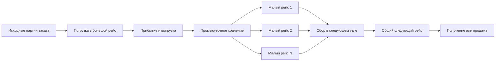

# Перевозки Skyhold: проект новой системы

Статус: проект для обсуждения и последующей реализации. Основан на коде PR #12, ревизия `322980d`. Рабочий код и данные мира этой подготовкой не изменяются. Старых рыночных договоров нет: конвертацию прежних заказов и параллельное исполнение двух рыночных моделей не проектируем. Существующие собственные корабли, их экипажи, деньги, местоположение и занятые рейсы учитываются как действующие ресурсы.

## 1. Рекомендуемое решение

Система планирует перемещение конкретного груза через реальные отправления транспорта. Размер партии определяется занятым транспортом на соответствующем участке. Один большой рейс может питать несколько маленьких; несколько подвозов могут собираться в один большой рейс. Расходы принадлежат физическим рейсам и операциям, а счёт заказа — его участию в них.

Игрок выбирает приоритет «Дешевле» или «Быстрее», получает готовый план и может закрепить компании, услуги, точки или собственный корабль. После изменения ограничений пересчитывается весь затронутый план, включая стыковки. Закреплённый выбор не заменяется автоматически.

В основе наёмного и собственного транспорта находятся одни единицы нагрузки, правила времени и расчёт эксплуатационных затрат. Коммерческая цена перевозчика и финансирование своего корабля рассчитываются поверх этой основы по разным понятным правилам.

Это переработка подсистемы перевозок, включая исполнение и финансовые операции. Одной замены поиска маршрута или формулы вместимости недостаточно.

## 2. Обязательные свойства

- Весь заказ сохраняет точные количества и происхождение груза при любом дроблении и объединении.
- Плата за один общий рейс не умножается на число его дочерних партий.
- Одинаковая компания не означает одинаковую машину или судно. Перегрузка отсутствует только при продолжении на том же физическом рейсе.
- Прибытие в промежуточный узел не означает поступления на склад поселения или завершения продажи.
- Время ожидания, обработки, движения, перегрузки и необходимого пустого подхода учитывается явно.
- Скорость, цена, доступность, скидки и доступ к товару относятся к конкретным предложениям и участкам.
- Самый быстрый план определяется прибытием всего заказа. Прибытие первой части показывается отдельно.
- У собственного корабля есть реальное местоположение, занятость, экипаж, вместимость и расходы. Его нельзя назначить одновременно на несовместимые рейсы.
- Рыночная доля организации определяет её присутствие, а не количество свободных кораблей.
- Расчёт, подтверждение, сохранённый договор и исполнение используют один план и одинаковые суммы.
- Повтор команды, пересчёт периода или перезагрузка не повторяют платёж, выдачу товара, продажу или страховую выплату.

## 3. Модель данных и единицы

| Сущность | Назначение |
| --- | --- |
| Заказ / consignment | Что и в каком количестве требуется доставить, откуда, куда, к какому сроку и на каких условиях |
| Исходная партия / lot | Конкретный источник товара, возраст, срок годности, стоимость, единицы и ограничения |
| Часть партии / allocation | Количество из исходной партии, помещённое на конкретный рейс или в промежуточное хранение |
| Участок карты / edge | Физическая связь, длина, УРС, допустимые способы, сезонные и географические ограничения |
| Услуга / service | Предложение организации: профиль транспорта, зона работы, расписание/доступность, тариф и правила брони |
| Физический рейс / run | Одно действительное отправление с транспортом, маршрутом, временем и манифестом |
| Узел передачи / buffer | Где находится груз между рейсами, когда готов к погрузке, как хранится и кто им владеет |
| Договор / agreement | Замороженные условия принятого плана, счета, допуски, страхование и правила отклонений |
| Событие / receipt | Однократно исполненное движение, платёж, передача, получение или компенсация |

`carrierId`, `serviceId`, `runId` и `vehicleId` — разные идентификаторы. Сквозная коммерческая скидка также имеет собственную ссылку на договор и не доказывает физическую непрерывность.

### Нагрузка

Каноническая нагрузка берётся из каталога ресурсов и профиля транспорта. В текущем коде корабли используют `loadPoints`, а рынок часто — `load`, где одна единица соответствует четырём points. Новый слой приводит данные к одной точной шкале один раз; независимые округления `load × 4` в разных адаптерах убираются.

Рекомендуемая внутренняя точность — целые тысячные `loadPoint`: один point равен 1000 внутренних единиц, обычная единица рыночной нагрузки — 4000. Избыточная точность входных значений проверяется явно. Ненулевой вес не округляется молча до нуля; явный нулевой вес допускается только как заданное свойство ресурса. В интерфейсе остаются обычные единицы нагрузки, одинаковые для рынка и своего корабля.

Например, существующее `capacityLoadPoints = 4000` собственного барка соответствует 1000 обычных единиц нагрузки. Рыночная вместимость 4000 обычных единиц соответствует 16000 points. Эти две характеристики нельзя приравнивать только по одинаковому числу 4000.

Количество отдельных предметов целое. Ящик или станок нельзя разрезать только ради вместимости. Навалочный товар делится с точностью его явно заданной единицы учёта. Допустимость разборки крупного предмета — отдельное свойство, а не автоматическое поведение перевозки. Размеры в тоннах не выводятся из игровых единиц нагрузки без настроенного соответствия.

### Время и деньги

Исполнение использует абсолютные QD существующего календаря; четыре QD составляют день. Дробное расчётное движение суммируется до конца непрерывного движения между настоящими остановками и затем округляется до QD. Дополнительная географическая точка без остановки не создаёт новую погрузку, отправку или округление.

Погрузка, выгрузка, подготовка и ожидание имеют свои длительности. Расходы в медных монетах округляются по определённому компоненту счёта, а распределение между заказами сохраняет точную общую сумму. Начисление за время считается накопительно: большой шаг календаря и несколько малых шагов дают одинаковый результат.

### Физическая доступность и УРС

Разделяются возможность проехать/пролететь через точку и возможность погрузить/передать там груз. Сквозной воздушный рейс может пройти транзитную точку без воздушного порта; начать или закончить погрузку там он не может. Наземное/межматериковое ограничение физического ребра продолжает действовать. Для передачи проверяются возможности обоих транспортов и узла.

Присутствие организации позволяет получить её услугу, но не доказывает покрытие всего пути. Сквозная линия или область чартера задаёт, через какие территории услуга действительно выполняется. Компания без предложения продолжения не везёт груз дальше только из-за первоначального выбора; при необходимости планируется передача в подходящем узле. Для своего судна действуют физическая доступность и игровые права, а не рыночная доля чужой компании.

УРС остаётся бюджетом доступности пути, а не расходуемым ресурсом. Для каждой цепочки груза проверяется сумма стоимости её физических связей и сложности товара. Пересадка не обнуляет эту сумму; десять одинаковых рейсов не умножают её на десять. Необходимый пустой перегон проверяется как собственный путь без сложности груза. Деньги и время таких перегонов учитываются фактически.

Сезонность и известные закрытия проверяются на планируемые даты прохождения, а не только по сезону в момент оформления. При длинном движении через календарную границу учитываются соответствующие интервалы скорости. Такое внутреннее деление не создаёт новые порты или отправления. Неизвестная будущая погода остаётся риском, а не скрытым обещанием точной даты.

## 4. Перемещение, дробление и сбор груза



У каждого количества в любой момент ровно один владелец физического состояния: исходный склад, конкретный рейс, промежуточный буфер либо конечный получатель. Бронь не является второй физической копией товара.

### Пример A: большой корабль → малые караваны

Условный груз — 4000 единиц нагрузки, корабль — 4000, караван — 400. Это иллюстративные величины, а не характеристика конкретного существующего судна.

| Стадия | Правильное поведение |
| --- | --- |
| Корабль | Один загруженный рейс на 4000 |
| Порт | Одна выгрузка общего манифеста, затем подготовка десяти караванных загрузок |
| Караваны | Десять физических отправлений по 400 с собственными датами |
| Учёт | Один корабельный расход и десять караванных, плюс фактические операции обработки/хранения |
| Получение | По мере прихода караванов; весь заказ завершён после последнего принятого количества |

Например: погрузка корабля QD 0–1, движение 1–5, выгрузка 5–6. Караваны отправляются в QD 8, 12, …, 44, каждый движется 8 QD и разгружается 1 QD. Первая часть приходит в QD 17, весь заказ — в QD 53. Погрузка каравана должна завершиться до его отправления. Это пример заданного расписания, не новая универсальная скорость транспорта.

Если вместо караванов доступен поезд на 6000 с отправлением QD 12, движением 6 QD и выгрузкой 2 QD, весь заказ прибудет в QD 20. Поэтому более позднее первое отправление следующего участка может быстрее завершить весь заказ.

### Пример B: малые подвозы → большой поезд

Груз на 2400 подвозят шестью караванами по 400. Поезд на 6000 может забрать их одним отправлением после готовности последней части. Цена — шесть подвозов и один поезд. При приоритете скорости допускаются два более ранних поезда, если это действительно ускорит выполнение заказа и пользователь принимает соответствующую цену.

### Пример C: корабль → караваны → поезд

Один корабль на 4000, десять караванов по 400 и затем один поезд на 6000. Узлы не обязаны сохранять прежний размер партий. Сбор в поезд объединяет манифесты, но не уничтожает сведения о разных товарах, возрасте и происхождении.

Объединение разрешено для совместимого груза с совпадающим следующим направлением и подходящими условиями хранения/перевозки. Оно ограничивается сроком заказа и годностью товара. Бесконечное ожидание ради заполнения транспорта запрещено.

### Ёмкость узлов и погрузка

У точки передачи есть отдельные ограничения: место для ожидающего груза, производительность погрузки/выгрузки, доступные одновременно места обработки и условия хранения. Это ресурсы, общие для конкурирующих бронирований. Они входят в план так же, как свободное место транспорта.

Если корабль привёз 4000, а порт может хранить только 800, выгрузить всё сразу нельзя. Возможны частичная выгрузка по мере ухода караванов, прямая передача в готовый следующий транспорт или другой порт. Остаток остаётся на корабле; корабль занят и несёт расходы ожидания до фактического освобождения. Получение в домашний склад также проверяет его вместимость и установленный способ переполнения. Не принятый складом груз сохраняется в предусмотренном конечном буфере, а не удаляется.

У каждой погрузочной операции есть манифест, начало и конец. Сборы за общий портовый визит и суммарный обработанный объём не повторяются из-за нарезки allocations. Отдельные караваны при этом могут иметь свои настоящие операции подготовки/погрузки.

## 5. Доступность транспорта

Нужны два явных вида внешнего предложения.

### Регулярный сервис

Заданы линия/точки, календарь отправлений, вместимость на сегментах, момент закрытия погрузки, тариф и условия пересадки. Несколько заказов занимают места одного `runId`. Брони всех поселений вычитаются из одной доступной вместимости.

Расписание является конкретным обязательством сервиса. Оно не выводится из рыночной доли. Если оно генерируется по конечному флоту, занятый транспорт и возвращение ограничивают следующие рейсы. Для простой линии требуемое число единиц не меньше округлённого вверх отношения времени оборота к интервалу отправлений. GM видит эту проверку при настройке.

Для упрощённого NPC-перевозчика допускается явно заданное опубликованное расписание с ограниченной доступной игрокам вместимостью без симуляции остального флота компании. Это объявленная модель услуги: она не должна маскироваться под известное количество машин. В обоих вариантах нет бесконечной вместимости в одном временном слоте.

### Выделенный транспорт

Задан конкретный транспорт либо конечный пул с местом и временем освобождения. Такой транспорт обслуживает выбранный маршрут и может продолжать движение через несколько точек без перегрузки. Новый выезд из исходного узла возможен после освобождения соответствующей единицы или за счёт другой свободной единицы пула.

Для внешнего чартера по умолчанию планируется возврат в пункт предоставления. Он имеет собственное время и расходы. Одностороннее предоставление включается явным условием услуги. Для собственного корабля пользователь выбирает возврат домой либо допустимое завершение в другой точке.

Регулярная линия одной компании и её же чартер — разные предложения. Два соседних участка одной компании убирают перегрузку только при совпадении физического рейса/сквозного сервиса. Разные суда той же компании требуют настоящей передачи груза.

### Базовые настройки

Без утверждённого расписания регулярные рейсы не выдумываются. Для страны/хаба можно создать предложение по шаблону: профиль транспорта, конечный пул, интервал готовности, время подготовки, погрузочная производительность, ставка обработки и правила возврата. Начальный шаблон чартера использует одну доступную единицу; увеличение параллельности задаётся явно.

Генерируемые значения показываются в предварительной настройке. Из присутствия организации нельзя автоматически создать по бесконечному флоту в каждой локации. Неизвестная доступность показывается как «требует подтверждения», а не как гарантированное немедленное отправление.

Независимые перевозчики — местный пул конкретного хаба/страны и способа, а не одна всемирная компания. Его наличие, доступность и непрерывность рейса учитываются отдельно. Скидка на перевозку организации не изменяет автоматически цену её товара: торговые и транспортные условия имеют разные области применения.

## 6. Компании, предпочтения и договорённости

### Три действия игрока

1. **Предпочитать компанию.** Мягкое предпочтение для равных/близких вариантов. По умолчанию не меняет первичный критерий «Дешевле» или «Быстрее». Допустимая переплата или задержка ради предпочтения задаётся игроком явно.
2. **Закрепить компанию/услугу на участке.** Обязательное ограничение. Остальная цепочка пересчитывается с ним. Недоступность не снимает закрепление.
3. **Исключить компанию.** Её услуги не участвуют в выбранном расчёте.

Игрок может редактировать перевозчиков после автоматического выбора. При закреплении показываются точные границы применимости: весь заказ, группа груза либо участок между устойчивыми локациями/связями. Ссылки не привязываются только к номеру строки, который меняется после пересчёта.

### Договор поселения с организацией

Договор хранится для пары «поселение — организация», а не как глобальное удешевление компании для всего мира. GM настраивает:

- область: транспорт, услуга, страны/локации, направление, при необходимости типы груза;
- начало/окончание действия и видимость заметок;
- скидку на определённые компоненты фрахта, фиксированную льготу, замену минимальной брони;
- доступ к специальному сервису, гарантированной квоте или приоритетной обработке;
- правила переноса и компенсации при нарушении стыковки.

Для первой версии достаточно скидки, минимальной брони, доступа/квоты и приоритета. Отсрочку оплаты и кредитный лимит лучше добавлять отдельным этапом через уже существующие финансовые обязательства.

Порядок применения цены фиксирован: условия услуги → явно заданная минимальная бронь/счёт → применимые договорные изменения → округление. Несколько скидок не перемножаются самопроизвольно: выбирается один подходящий договор на компонент либо явно заданное правило GM. Изменения не затрагивают налоги, страховку и чужие портовые сборы без отдельного условия их покрытия.

Скидка может сознательно дать цену ниже себестоимости, если GM задаёт субсидию или льготный договор; скрытый нижний порог не должен отменять такую договорённость. Общее отношение/репутация не превращается в автоматическую денежную скидку без установленного правила.

Автоматический итоговый фрахт не бывает отрицательным. Выплата субсидии сверх цены оформляется отдельной финансовой операцией, а не создаёт прибыльный цикл перевозок. Фиксированная льгота имеет явную кратность — на заказ/бронирование/рейс; нарезка груза не размножает её. По умолчанию срок действия скидки проверяется на дату принятия; условие «отправиться до даты» указывается отдельно.

Компания, услуга и действовавший договор фиксируются при принятии заказа. Истечение скидки после принятия не переписывает уже согласованные суммы. Приоритет не вытесняет уже подтверждённые чужие брони, если отдельный сценарий такой замены не согласован.

## 7. Единый корень расчёта затрат

Ввести чистый расчёт `calculateTransportOperatingCosts` с адаптерами корабля, каравана и поезда. Он получает профиль транспорта, реальный состав экипажа или стандартный штат, путь, загруженные/пустые перемещения, время ожидания/обработки и местные ставки.

Ядро получает уже подготовленные ставки и не читает Foundry или состояние мира само. Снабжение оценивается по снимку местных товарных цен; для оценки еды корабля не запускается рекурсивно поиск доставки этого же корабля. Направление зависимостей: нормализованные данные → ставки → общие затраты → план → authority и UI.

```text
Движение = сумма(длина участка / скорость × условия участка)
Себестоимость рейса = подготовка + экипаж + питание/фураж + топливо,
                     если оно предусмотрено профилем + содержание + операции
Цена внешней услуги = согласованный тариф поверх себестоимости
                     − договорные льготы + явно названные дополнительные услуги
Смета доставки = цены внешних услуг + расходы своего транспорта
                + только ещё не включённые сборы/пошлины/страховка
```

Корабль получает собственные скорость, трюм, реальное жалование, состав команды и профиль содержания. Внешний перевозчик получает стандартный профиль соответствующего класса, нормы снабжения, коммерческую надбавку и условия продажи места. Общий корень означает одинаковую физику и состав затрат, а не одинаковую вместимость всех судов или равную коммерческую цену.

Пустой подход и возврат добавляются конкретными перемещениями. Универсального умножения стоимости всех участков на два нет. Полная смена экипажа/транспорта, загрузка и простой имеют самостоятельные основания.

### Продажа места и чартер

Регулярный сервис продаёт забронированное место по опубликованному тарифу, основанному на профиле рейса и заданной коммерческой загрузке. Мелкий заказ оплачивает место и установленный минимум, а не весь корабль. Большой может занять всю свободную вместимость. Произвольные обязательные ограничения 20%/10% на весь заказ убираются; ограничение доли возможно как явное условие конкретной услуги.

Чартер оплачивает реально предоставленный транспорт и согласованные пустые перемещения. Если один корабль несёт весь заказ, его полная смета возникает один раз. Последующие десять караванов имеют десять своих смет.

Ценность груза влияет на пошлины, страхование, охрану и явно объявленную ответственность. Скрытый универсальный минимум фрахта в процентах от цены товара не переносится как физическая себестоимость. Если он нужен для игрового баланса конкретной компании, это видимый компонент её коммерческого тарифа.

Ускорение достигается более ранним отправлением, меньшим ожиданием, приоритетной обработкой или другим действительным профилем транспорта. Оно не умножает физическое время всех участков на произвольные 0,7 при неизменном транспорте.

### Финансовые компоненты

Каждый сбор имеет основание, плательщика, получателя и однозначного владельца начисления. Погрузка/выгрузка возникают по реальной передаче манифеста. Сквозное прохождение точки не создаёт повторного сбора. Растаможка привязана к установленному налоговому правилу/границе, а не к каждому нарисованному узлу.

Компонент явно помечается как включённый в тариф либо оплачиваемый отдельно. Если компания уже включила погрузку в свой счёт, заказ не добавляет её второй раз. Аналогично один и тот же портовый сбор не списывается одновременно корабельным адаптером и рыночной операцией.

Для первой версии используются существующие настроенные экспортные и импортные правила. Дополнительные транзитные сборы появляются только при явной настройке; их нельзя выводить из каждого пересечения линии карты. Льготы и ранее оплаченная пошлина учитываются через receipt, чтобы дробление не создавало повторное начисление.

Общая стоимость рейса распределяется между его allocations точными целыми долями. Сумма долей равна счёту. При этом расчёт себестоимости общего рейса и счета отдельных клиентов — разные записи. Присоединение другого заказа к регулярному рейсу не меняет уже принятую цену. Совместный чартер разных заказов в первой версии требует явного общего подтверждения; молчаливого перераспределения оплаченных счетов нет.

## 8. Собственный корабль в общей цепочке

Корабль поселения можно использовать для покупки, продажи и подходящей части смешанного маршрута. Например, он везёт груз до материкового порта, передаёт его железной дороге и возвращается домой. Заказ продолжает движение независимо от возвращения корабля.

Для закупки вдали учитывается пустой подход собственного судна к месту получения товара. Корабль, уже находящийся в подходящей локации, начинает оттуда. Проверяются маршрут, трюм, экипаж, исправность, существующий рейс/составной заказ, время освобождения и право управления.

По умолчанию автоматический подбор использует свободные готовые суда. Достоверно запланированное освобождение можно учитывать как будущую доступность; неизвестное завершение после решения GM не выдаётся за гарантированную дату. Присоединение к действующему составному рейсу допускается только через его штатное планирование и проверку трюма на каждом сегменте.

### Расходы, перевод и резерв

В интерфейсе разделяются:

| Показатель | Значение |
| --- | --- |
| Расходы по плану | Что будет потреблено рейсами и услугами при штатном исполнении |
| Оплатить внешним сторонам | Фрахт, налоги, страховка и прочие согласованные счета |
| Перевести на борт | Внутреннее перемещение денег из казны для финансирования |
| Резерв | Дополнительные деньги на допустимый простой/отклонения; их наличие не равно расходу |
| Фактически израсходовано | Уже исполненные расходы по receipts |

Пример: расходы рейса 300 ММ, резерв 100 ММ, свободно на борту 150 ММ. Требуется перевести 250 ММ. Расход по плану остаётся 300 ММ; перевод 250 не добавляется к нему второй раз. Неиспользованный резерв учитывается как оставшиеся деньги. Наличие денег на борту не делает стоимость доставки нулевой.

Сравнение «Дешевле» использует полную смету доставки, включая запланированный собственный подход/возврат. Это критерий доставки, а не оптимизация всей экономики поселения с вычитанием гипотетического альтернативного домашнего содержания. Домашнее и рейсовое начисление одного и того же интервала экипажа не дублируются.

Плановые деньги резервируются при подтверждении. Расход собственного физического рейса проводится один раз через корабельный учёт при фактическом отправлении, как предоплаченный интервал. Другой обработчик периода не начисляет его снова. Дополнительное ожидание учитывается отдельно согласно договорному пределу; необходимые будущие рейсы, включая возврат, имеют собственные расходы и события.

Для защиты финансирования рекомендуется отдельный денежный резерв заказа. Деньги перемещаются в него как внутренний перевод и становятся недоступны банку, строительству и другой покупке; счета затем оплачиваются из этого резерва без повторного изъятия из казны. Свободный, зарезервированный и фактически потраченный остатки различаются. Аналогично учитывается уже имеющаяся зарезервированная сумма на борту. Общая сумма денег не уменьшается от одного перемещения между своими счетами; при освобождении резерва возврат проводится однократно.

Покупка товара оплачивается по рыночному договору и не оплачивается вторично капитаном при погрузке. В первой версии физическую транспортировку монет за товар не вводим. Выручка при продаже своим кораблём на конечном рынке поступает на борт по действующему правилу; если конечную сделку исполняет наёмный сервис после промежуточной передачи, используется рыночное зачисление в казну. Получатель денег фиксируется для соответствующего количества при подтверждении.

## 9. Приоритеты и ручное редактирование

Определения:

- `C` — полная согласованная смета доставки, без цены самих приобретаемых товаров и без повторного прибавления внутренних переводов/резерва;
- `T_all` — момент получения всего требуемого пригодного груза;
- `T_first` — момент получения первой части, информационный показатель;
- выбранная страховка, разрешённые компании/свои суда, крайний срок и денежные ограничения — условия поиска.

Приоритет «Дешевле»: минимизировать `(C, T_all, количество перегрузок)`. Приоритет «Быстрее»: `(T_all, C, количество перегрузок)`. Детерминированный идентификатор разрешает полные равенства. Для сравнения покупки и продажи транспортная цель одинакова; экономический итог самой сделки показывается отдельно.

Пользователь может ограничить срок, бюджет, компании, виды транспорта и использование своего флота. Переключение приоритета сохраняет закрепления. Отдельная команда сбрасывает их. После изменения перевозчика показывается изменение цены, первого/последнего прибытия, перегрузок и финансирования.

Разные маршруты частей заказа допустимы, когда это помогает сроку или требуется свойствами груза. Группы с несовместимыми условиями планируются отдельно, а их конкуренция за общие места учитывается вместе. Пользователь может потребовать одну цепочку для всего груза. Автоматический поиск работает в пределах выбранного режима и не снимает такие ограничения сам.

Страхование не отключается ради искусственного удешевления. Порча или недоставка части заказа не считаются успешным быстрым/дешёвым выполнением полного заказа.

Даты являются плановыми при зафиксированных условиях; скорость выбирается по ним. Неизвестные происшествия не позволяют обещать гарантированное прибытие. Аналогично смета, фактический расход и предельная разрешённая доплата показываются раздельно.

## 10. Поиск и производительность

Каталог рынка и поиск перевозки разделяются. Ассортименту достаточно существующей предварительной доступности/УРС. Поиск перевозки запускается для выбранных количеств, услуги, ограничений и доступного флота. Поиск текста, раскрытие карточки и переход страницы вариантов не запускают его заново.

Рекомендуемый pipeline:

1. Собрать неизменяемый снимок графа, услуг, свободных мест, договоров, источников груза и своих кораблей.
2. Отфильтровать заведомо неподходящие способы, неделимые размеры, территории, права и закрепления.
3. Вычислить оптимистичные нижние оценки времени и стоимости для конкретного груза. Они игнорируют часть ожиданий/расходов, но никогда не завышают минимум.
4. Быстро получить несколько допустимых начальных планов: цена, срок, использование подходящего своего судна. Это верхние границы, а не доказательство оптимальности.
5. Лениво раскрывать перспективные пути, услуги, слоты и варианты сборки. Считать реальный поток и расходы по одной модели, отсекать состояния по доказуемым границам и полному влияющему состоянию.
6. Большие однородные количества обрабатывать блоками по вместимости/событиям, а не создавать объект для каждой единицы товара.
7. Возвращать лучший допустимый план и качество результата. Улучшение можно продолжить без изменения текущего выбора до его принятия.

Ограничение «просмотреть первые восемь маршрутов» не доказывает, что найден самый дешёвый. Совместный выбор маршрута, упаковки неделимых товаров, фиксированных расходов, сборки и конечного флота сложнее обычного кратчайшего пути. Быстрый предварительный упаковщик допустим для начальных решений; он не подменяет доказательство оптимальности.

Контракт результата поиска:

| Статус | Поведение UI |
| --- | --- |
| Оптимум подтверждён в заданной модели/горизонте | Можно писать «Самый дешёвый» / «Самый быстрый» |
| Найден допустимый план, поиск ограничен | «Лучший найденный по цене/сроку», видимые сумма/даты и возможность продолжить поиск |
| Недопустимость доказана | Конкретная причина: связность, размер, УРС, время, деньги или закрепление |
| Лимит до первого допустимого плана | «Поиск не завершён»; отсутствие связи не утверждается |

Допустимый вариант с неподтверждённым оптимумом можно принять осознанно: его физическая и финансовая корректность полностью проверена. Неопределённость касается только существования более выгодной альтернативы.

Планирование ограничено игровым горизонтом: рекомендуемый начальный — 90 дней с видимой возможностью расширения и отдельным крайним сроком заказа. Оптимальность относится к этому горизонту и выбранным ограничениям. Ожидание годами ради неопределённой экономии не возникает скрыто.

Чистый поиск получает входной снимок и может выполняться в отдельном Worker либо с кооперативными паузами; существующие lazy boundaries сохраняются. Новый запрос отменяет устаревший. Кэш учитывает количества, ограничения, роль, граф, расписание/брони, условия и состояние кораблей. Цели отклика — быстрый предварительный ответ и обычный расчёт порядка секунды; это критерии будущих benchmark, не обещание для любой сети.

## 11. Подтверждение, резервирование и хранение

Пример предлагаемого разделения данных:

- `catalog`: профили транспорта, услуги, календари, правила передачи/хранения и коммерческие тарифы;
- `holdings[id]`: договорённости с организациями, заказы, манифесты, промежуточные партии, финансовые receipts и ссылки на свои суда;
- `meta.sharedTransport`: общие брони слотов и ресурсов внешних сервисов, чтобы два поселения не заняли одно и то же место;
- существующие объекты собственного флота: фактическое местоположение, занятость, кошелёк и рейсы; ссылки из заказа не создают вторую копию корабля.

Это предложение контракта данных, не уже внесённая схема. Основное раздельное хранилище и commit-marker recovery сохраняются. Новые версии контрактов вводятся явно. Конвертации старых рыночных заказов нет; наличие существующих рейсов флота проверяется перед выделением ресурсов.

Черновик не резервирует деньги и место. При подтверждении authority-GM одной существующей атомарной операцией проверяет ревизию, токен условий, конкретные партии и спрос, скидку, слоты, трюм/экипаж/местоположение, деньги по счетам и точный план. Затем фиксирует покупку/резервы/предоплаты, брони и договор с одним `operationId`.

Повторно искать глобальный оптимум внутри транзакции не требуется: authority независимо проверяет конкретный выбранный план и пересчитывает его стоимость общим ядром. Устаревшие условия требуют нового подтверждения. Частично оплаченного или частично забронированного результата после отказа не остаётся.

Запись учитывает expected/actual время, источник каждой allocation, список рейсов/операций, применённые договоры, ответственность за сборы, счёт получения выручки, страховую политику, допуски перепланирования и версию расчёта. Принятые условия не меняются при последующем редактировании каталога.

При покупке оплаченные товары становятся принадлежащими поселению партиями у поставщика и ожидают загрузки там; с этого момента учитывается их возраст. При продаже складские партии остаются на домашнем складе под бронью до фактического отправления. Внешние stock/demand и их освобождение/погашение обновляются по тем же конкретным количествам, без двойного вычитания на каждой пересадке.

Бронь исходящего количества должна соблюдаться всеми потребителями склада: ручным изъятием, другой продажей, производством, снабжением и иными автоматическими операциями. Рекомендуется выделить защищённые allocations в резерв груза: они физически находятся в том же помещении и занимают его ёмкость, но исключены из обычного доступного количества. Это позволяет сохранить партии и не рассчитывать на то, что каждый потребитель сам вспомнит про бронирование. В интерфейсе видны всего/доступно/зарезервировано. Отправление переносит резерв в transit; второй раз изымать исходное количество нельзя. Отмена возвращает оставшееся количество в доступное состояние один раз.

При ручном GM-изменении забронированного груза или экипажа затронутый план требует явного исправления; рейс не получает отсутствующий товар или людей автоматически.

### Общие рейсы и часы разных поселений

Для общих слотов требуется одна абсолютная логистическая дата мира. Локальные курсоры экономического расчёта поселений могут отставать; их нельзя смешивать при определении одновременных броней.

Фактические события общего рейса фиксируются один раз в общем журнале. Изменения склада/казны конкретного поселения применяются по этим receipts на соответствующей границе его экономического расчёта. Это позволяет не выдавать товар будущего периода в расчёт более раннего дня. Повторное применение на другом клиенте не создаёт новую физическую перевозку.

Новое подтверждение использует актуальную дату мира и требует согласованного состояния логистики поселения и назначаемого судна. Если локальный расчёт отстал, UI предлагает сначала обработать нужный период; оформление не задним числом занимает прошедший слот. Предварительный расчёт периода использует копии и не расходует глобальные места или деньги. Возврат календаря назад не откатывает уже исполненные события автоматически.

## 12. Исполнение, возраст груза и риски

Ввести единый `advanceLogistics(targetQd)` с очередью абсолютных событий. В одной точке времени сначала обрабатывается прибытие/освобождение, затем окончание выгрузки/готовность груза, затем допустимое отправление. Погрузка должна действительно закончиться к закрытию посадки. У каждого события уникальный устойчивый ID и запись об исполнении.

Корабельный адаптер связывает эти события с `departWorldShip` / `advanceWorldShips`. Один собственный корабль не продвигается независимо рыночным таймером и ещё раз общей экономикой. Вызовы на крупных шагах времени исполняют те же причинно упорядоченные события, что и последовательность малых шагов.

Возраст товара продолжается на складе, в пути и в буфере. До отправления зарезервированная исходящая партия стареет в исходном складе; после него — в единственном transit-состоянии. Дробление и сбор сохраняют возраст и стоимость исходного lot. Хранение может требовать оплаты и иметь профиль сохранности; бессрочное бесплатное идеальное хранение не предполагается.

Происшествие принадлежит физическому рейсу/сегменту риска. Все находившиеся на нём количества получают общий результат. Дочерние партии не бросают независимо десять штормов за один корабельный переход. Свой корабль и рыночный заказ также не создают два независимых происшествия одного события. Порча отдельных товаров зависит от их партии и условий.

Seed/ID события фиксируются и не меняются повтором команды или перепланированием уже выполненной части. Страховой лимит относится к исходному количеству и полису; split/merge не увеличивает предел выплат. Выплата имеет собственный idempotent receipt.

Часть груза поступает на склад только при конечном получении. Исходящая продажа закрывает спрос и начисляет выручку по фактически принятому пригодному количеству, без ожидания остальных независимых частей. Общий заказ показывает выполнено/в пути/ожидает/утрачено; завершение и исполнение в полном объёме различаются.

## 13. Отклонения, отмена и перепланирование

- Изменение до подтверждения: сохранить закрепления, предложить новый план, ничего не списывать автоматически.
- Задержка после принятия: пересчитать готовность и реальные стыковки. Уже ушедший поезд нельзя догнать задним числом.
- Следующий эквивалентный слот того же сервиса можно использовать автоматически только в заранее принятых пределах цены/времени и правил переноса.
- Новый перевозчик, дополнительные расходы сверх допуска, другой свой корабль или нарушение обязательного срока требуют подтверждения ещё не выполненной части.
- Груз, ожидающий после сбоя в чужом порту, остаётся собственностью поселения в указанном buffer. Он не возвращается на домашний склад автоматически.
- Отмена освобождает будущие брони и возвращает только неиспользованные суммы согласно договору. Выполненные рейсы не откатываются.
- Возврат купленного товара поставщику — отдельное условие/операция; отмена доставки не уничтожает уже приобретённый груз и не гарантирует полный возврат его цены.
- Невыполнимую часть можно хранить, перенаправить или вернуть новым планом. Точная судьба количества видна в заказе.
- Ошибка внутреннего учёта останавливает затронутый поток с диагностикой. Нормализация не «исправляет» расхождение удалением груза/денег.

Условие об отклонениях входит в подтверждение. Рекомендуемый первый режим — без автоматической доплаты; автоматический перенос разрешён только в равноценное уже оплаченное предложение. Прочие ветви заказа продолжаются, если не зависят от остановленного рейса.

## 14. Интерфейс игрока и GM

### Оформление

1. Выбрать товары/количества и назначение. Для продажи — исходные складские партии по существующим правилам FIFO/доступности.
2. Выбрать «Дешевле» или «Быстрее», страховку, срок/бюджет и разрешение использовать свои суда. По умолчанию собственное судно не отправляется без явно разрешённого выбора флота.
3. Получить краткий результат: полная смета, деньги к оплате/переводу, первое/последнее прибытие, число загруженных рейсов и перегрузок, качество поиска.
4. Раскрыть путь. Увидеть «1 корабль на 4000 → 10 караванов по 400 → 1 поезд», а не десятки одинаковых сквозных карточек.
5. У выбранной стадии сменить компанию/услугу, применить предпочтение, исключение или закрепление. Видеть скидку поселения и итоговое изменение цены/срока.
6. Проверить счета, бронь своего судна, возврат/завершение рейса и допустимые отклонения; подтвердить один конкретный план.

Выбор компании имеет поиск и компактный список: цена для этой стадии и объёма, готовность/срок, вместимость, применяемая льгота и причина недоступности. Подробности физических рейсов раскрываются отдельно с ограниченной высотой и доступной клавиатурой прокруткой. Для длинного разветвлённого заказа — сводка стадий и детали выбранной ветви.

После подтверждения отслеживаются фактические местоположение, ближайшее событие, готовые к получению количества и причины остановки. «Редактировать черновик» и «Перепланировать остаток принятого заказа» — разные действия. Сохранённый договор не перерисовывается по текущим ценам.

### Права

Игрок, имеющий доступ к поселению, может просматривать разрешённые предложения и собирать локальный черновик. Подтверждение покупки/продажи требует `canUseStorage`; назначение своего судна — также `canManageShips`. Это должно проверяться одинаково в UI и authority, включая исходящую продажу, где сейчас часть действий явно ограничена GM.

Договорные скидки, NPC-расписания, профили и ручные компенсации настраивает GM либо отдельно уполномоченная роль. Игрок не редактирует размер собственной скидки из окна заказа. GM-only компании, условия и заметки скрываются в обычных окнах игрока согласно существующей модели доверенного стола.

То же представление по роли используется в подтверждениях, чат-сообщениях, уведомлениях и отчётах периода. Общая занятость сервиса показывается без содержимого чужих скрытых заказов.

Без активного authority-GM остаются просмотр и локальный черновик. Подтверждение не пишет напрямую в world settings игрока. Используются существующие сокет, `operationId`, ревизии, повтор и результат команды.

## 15. Что потребуется настраивать

| Настройка | Источник / рекомендуемое поведение |
| --- | --- |
| География, допустимые способы, УРС и сезонность | Уже существующая карта и локации |
| Реальный класс транспорта | Общий профиль с нагрузкой, скоростью, штатными затратами и обслуживанием |
| Присутствие компании | Существующие страны/доли по режимам; отдельно от свободного флота |
| Доступность | Регулярное расписание либо конечный пул выделенного транспорта |
| Сквозная линия | Явный сервис/рейс, объединяющий несколько физических рёбер |
| Погрузка/выгрузка | Производительность узла, подготовка операции и сборы |
| Промежуточное хранение | Цена/условия, ограничение при необходимости; безопасный шаблон без обязательного нового редактора склада |
| Договор поселения | Применимость, льготы, минимальная бронь, квота и срок |
| Возврат и переносы | Условие услуги/своего судна и пределы согласованных отклонений |
| Планирование | Горизонт, бюджет/срок, разрешённые ресурсы и качество найденного решения |

Для первого запуска нужен предварительный экран соответствия существующих настроек новым профилям. Особенно важно показать различие рыночной нагрузки и корабельных points. Существующие пользовательские вместимости не перезаписываются молча усреднённым профилем.

Для обычной настройки GM достаточно выбрать шаблон транспорта, хаб, конечную доступность, условия отправления/возврата и тариф. Сложные настройки узла и регулярной линии раскрываются отдельно. Внешние NPC-единицы могут быть виртуальными ресурсами планировщика, создаваемыми лениво из конечного пула; импорт Foundry Actors для этого не нужен.

## 16. План внедрения

Рекомендуется отдельная ветка/PR после завершения PR #12. Сначала реализация ядра и контрольных сценариев, затем включение в пользовательское оформление. Выпуск не должен одновременно запускать старый и новый исполнитель для одних и тех же грузов.

Предлагаемое разделение владельцев:

- `scripts/data/transport/`: профили, услуги, договорённости, неизменяемый план и нормализаторы;
- `scripts/engines/transport/`: чистые затраты, служебный граф, упаковка, поток/расписание, поиск и проверка конкретного плана;
- адаптеры рынка и собственного судна: преобразование существующих сущностей в общие входы и результаты; Foundry API не попадает в чистое ядро;
- `scripts/workflows/transport/`: подтверждение, бронирование, события, отмена и перепланирование через существующий authority-протокол;
- действующие market/ship приложения: представление, выбор ограничений и вызов workflow; расчётная логика из render/кликов в них не добавляется;
- `scripts/apps/domains/finance/economy-domain.js`: интеграция единой логистической шкалы с границами периода, без двойного продвижения своих судов.

| Этап | Изменения и владельцы | Условие завершения |
| --- | --- | --- |
| 1. Контракты и единицы | Чистые data-типы в `scripts/data/`, адаптеры каталога нагрузки и профилей | Сохранение количества, точная нагрузка, понятная схема счетов и таблица defaults |
| 2. Общее ядро затрат/времени | Новый чистый транспортный модуль; адаптация `ships/profiles.js`, `ships/world-market.js` и рыночных тарифов | Одинаковые входные данные дают одинаковые затраты; нет двойного экипажа/погрузки/пошлины/округления |
| 3. Услуги, слоты и договорённости | Каталог профилей/услуг, нормализация льгот, общий реестр резервов | Конкурирующие брони не превышают вместимость; присутствие компании не порождает бесконечный флот |
| 4. Поток груза | Чистый планировщик партий, рейсов, буферов и стыковок | Контрольные split/merge дают правильное число рейсов, сумм и дат |
| 5. Оптимизатор конкретного заказа | Замена универсального перебора; нижние оценки, ленивый поиск, отмена/кэш | Цена/срок совпадают с exhaustive oracle на малых случаях; качество результата честно обозначено |
| 6. Authority/счета | `apps/market/authority-context.js`, executor, workflows, общий reserve ledger | Одна атомарная бронь, один платёж; конфликт/повтор не оставляет частичных эффектов |
| 7. Исполнение | `market/shipment.js`, `market/outbound.js`, `workflows/market/`, адаптер `ships/world-voyage.js`, оркестратор периода | Единые события, причинный порядок, большая/малая перемотка равны, нет дублирования судна/груза |
| 8. UI и разрешения | `market-app.js`, карточки компаний/стадий, профильные шаблоны/CSS; существующие ship dialogs | Игрок проходит тот же поддержанный workflow, понятны цены/переводы/даты, сохранены фокус и выбор |
| 9. Включение | Предварительная настройка, документация, статические проверки, отдельный ручной smoke | Нет старых рыночных заказов; текущие суда/деньги/партии корректно отражены; runtime проверен в согласованном объёме |

Старый рыночный расчёт `min(capacity)` и универсальная нарезка не остаются скрытым запасным путём. После переключения они удаляются из активного исполнения вместе с устаревшими тестовыми ожиданиями. Прежние проверки сохранности денег/прав/повтора переиспользуются для новой модели. Действующие API корабля сохраняются через адаптер, а публичные новые расчётные контракты получают явную версию.

Подготовка схем, previews и офлайн-проверок не выполняет обновление мира. Конкретное включение/перенос настроек требует отдельной разрешённой операции. Отсутствие старых заказов позволяет убрать их миграцию, но не разрешает удалять существующие ресурсы мира.

## 17. Приёмочные сценарии

1. **4000 → 400:** один корабль, десять караванов; оплачены реальные рейсы, а не десять кораблей.
2. **400 → 6000:** несколько подвозов собираются в один большой рейс; более ранняя частичная отправка сравнивается по целому заказу.
3. **4000 → 400 → 6000:** повторные split/merge сохраняют количества, возраст, стоимость и точный общий счёт.
4. **Мелкий груз:** используется место регулярного рейса/разумный минимум. Полный чартер показывается как отдельная альтернатива.
5. **Неделимая крупная единица:** не проходит через меньший транспорт; предложен другой способ/маршрут либо конкретный отказ.
6. **Одна компания, разные суда:** льгота действует; перегрузка и ожидание сохраняются. Один настоящий сквозной рейс не платит подготовку повторно.
7. **Дешевле/быстрее:** сравниваются полная смета и `T_all`; ранняя первая часть не подменяет завершение всего заказа.
8. **Ручное закрепление:** смена фирмы пересчитывает стыковки, скидку и финансирование; исчезнувшая фирма не заменяется сама.
9. **Скидка одного поселения:** не применяется другому; изменение после подтверждения не меняет принятый счёт.
10. **Свой корабль:** покупка с пустым подходом, продажа, промежуточная передача, возврат/завершение в другой точке. Учтены все затраты, переводы не задвоены.
11. **Занятый корабль:** два игрока не бронируют его одновременно; недостаток экипажа/денег/трюма имеет понятную причину.
12. **Общий внешний рейс:** два заказа/поселения используют общий лимит места; новый клиент не переписывает старую цену.
13. **Сбой общего судна:** все соответствующие allocations имеют один исход; следующий караван другой ветви не получает чужой шторм.
14. **Страхование:** split/merge, повтор события и частичная продажа не размножают страховую сумму или выплату.
15. **Порча:** ожидание и перегрузка старят конкретные партии. План с недопоставкой не помечается полным успешным выполнением.
16. **Опоздание на стыковку:** ушедший рейс не используется задним числом; следующая бронь и доплата соответствуют принятым условиям.
17. **Отмена:** освобождаются будущие ресурсы; купленный груз и выполненные расходы не исчезают.
18. **Повтор/перезагрузка:** принятие, продвижение времени, склад и выручка однократны; крупный шаг совпадает с последовательными малыми.
19. **Права/обычный UI:** GM/player, разрешение склада и своего флота, отсутствие GM, скрытые условия, конкурирующие команды.
20. **Нагрузка:** длинная цепочка с тремя способами, разветвлённая карта, несколько компаний и крупный одинаковый груз. Измеряются отдельно подготовка графа, планирование, проверка принятия и отрисовка. Поиск текста в вариантах не пересчитывает логистику.
21. **Порт меньше корабля:** частичная выгрузка сохраняет остаток на борту, занятость и расходы ожидания; прямой cross-dock возможен только при готовом следующем транспорте.
22. **Погрузочная очередь/домашний склад:** два рейса не занимают одно место обработки; переполнение не удаляет прибывший товар и не объявляет его уже принятым складом.
23. **Разные курсоры поселений:** общий рейс/слот один, а его получение не попадает в более ранний период другого поселения; опоздавший локальный расчёт не создаёт бронь задним числом.
24. **Другие потребители склада/экипажа:** производство, питание, изъятие и другой заказ не расходуют защищённое количество; переназначение экипажа забронированного судна выявляется до отправления.

Минимальные автоматические инварианты: ни одно количество не исчезает/не удваивается; суммы распределений равны счетам; загрузка каждого сегмента допустима; транспорт не находится в двух местах одновременно; отправление не предшествует готовности; продолжение после лимита не называется доказанным оптимумом.

Для денег проверяется и общий баланс: начальные деньги плюс реальные поступления минус исполненные расходы равны сумме свободных и зарезервированных остатков на всех своих счетах. Перевод в резерв/на борт не считается дополнительным расходом. Для хранения и бронирования необходимы сбои на каждом шаге split-commit: восстановление сохраняет согласованность meta, holding и receipts.

## 18. Границы первой версии

В первую версию входят все основные пользовательские требования: фирмы и договорные льготы, цена/скорость с ручным редактированием, реальные split/merge, собственный корабль на подходящем участке и единый расчёт затрат, права игроков, подтверждение/исполнение и прозрачный статус поиска.

Отдельными расширениями остаются сложный физический объём/габариты сверх заданных ограничений, самостоятельная экономика всего NPC-флота, перевозка монет как физического груза, динамическое переоформление совместного чартера уже оплаченных разных заказов и кредитование перевозок. Их точки расширения предусмотрены, но они не должны задерживать правильную основную доставку.

## 19. Оценка использования и сложности внедрения

Для обычной покупки целевой workflow остаётся коротким: товар/количество → «Дешевле» или «Быстрее» → просмотр суммы/дат → подтверждение. Пользователь не распределяет вручную 4000 единиц по десяти караванам. Подробности открываются для выбора любимой фирмы, своего корабля или разбора задержки.

После первоначальной настройки GM основные источники ручной работы — новые услуги, значимые договорённости и исключительные происшествия. Обычные рейсы, загрузка, стыковки и разнесение счетов выполняются автоматически по принятым правилам. Шаблоны должны скрывать необязательную сложность, сохраняя видимыми причины ограничений.

По объёму это отдельный функциональный этап. Наибольший риск находится в общем учёте денежных/товарных резервов, причинном исполнении времени и единственном владельце расходов собственного судна. Их следует завершить и проверить до включения нового оформления. Настройка компаний и карточки UI идут поверх этих контрактов, а не определяют финансовую модель.

Преимущество предлагаемой схемы — единый план объясняет и цену, и реальное движение груза. Цена сложности — настройка настоящей доступности услуг и более строгий учёт промежуточных состояний. Ограниченный поиск с честным статусом позволяет пользоваться корректным найденным вариантом даже в сети, где полный оптимум ещё не доказан.
