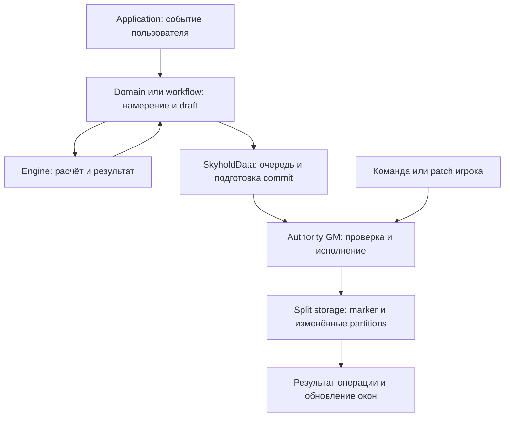

**Навигация по исходникам FBL Skyhold**

Начальная точка — [main.js](main.js): `init`, `ready`, публичный API, socket listener и открытие менеджера. [AGENTS.md](../AGENTS.md) задаёт ограничения изменений; [структурный аудит](../docs/code-structure-audit-2026-10-24.md) объясняет сильные и сложные места архитектуры.

**Где искать владельца поведения**

| Что меняется | Основные владельцы |
|---|---|
| Главное окно, вкладки, сбор контекста | `apps/skyhold-app.js`, `apps/domains/ui-domain.js`, `apps/domains/building/rows-domain.js` |
| Регистрация и вызов UI actions | `apps/events/action-router.js`, `apps/common/delegated-events.js`, `apps/domains/events/` |
| Повторный render, закрытие, сохранение поля, фокус | `apps/common/render-scheduler.js`, `pending-field-saves.js`, `save-status.js`, `window-frame.js`, `window-focus-keeper.js` |
| Вторичное окно и его первая загрузка | `apps/lazy-apps.js`, `template-preload.js`, `lazy-styles.js`; затем класс нужного окна |
| Изменение данных, очередь и запись | `data/store.js`, `commit-preparation.js`, `write-queue.js`, `split-storage.js`, `storage-commit.js` |
| Команда игрока и подтверждение GM | `data/socket.js`, `ship-socket.js`, `politics-socket.js`, `socket-auth.js`, соответствующий `apps/*-operation-executor.js` |
| Разрешённые изменения игрока | `data/holding-permissions.js`, `player-write-guard.js`, правила специализированной команды |
| Схема, обычная загрузка, старые данные | `data/schema/`, `data/normalizers.js`, `data/normalizers/`; явные миграции — `workflows/buildings/`, `workflows/economy/` |
| Хозяйственный период и его фазы | `apps/domains/events/economy-events.js`, `apps/domains/finance/economy-domain.js`, `engines/tenday/` |
| Производство, еда, расходы, сельское хозяйство | `engines/economy/`; адаптеры состояния и сервисов — `apps/domains/finance/` |
| Рынок и доставка | `engines/market/`, `data/market/`, `workflows/market/outbound-shipment.js`; UI — `apps/market-app.js` |
| Корабль и экипаж | `engines/ships/`, `apps/ship-operation-executor.js`, `apps/ships-context.js`, `apps/ship-app.js` |
| Рабочие, штат, QD и план | `data/hybrid-labor.js`, `work-allocations.js`, `workforce-plan.js`, `engines/workers/`, `apps/domains/workforce-planner.js` |
| Политика и её влияние на расчёты | `engines/politics/`, `data/politics-*.js`, `apps/politics-decision-context.js` |
| Массовый бой | `apps/mass-combat/`: `calculator`, `round-resolution`, `casualties`, `damage`, `supplies`; окно — `apps/mass-combat.js` |
| Foundry, календарь, отметки сцены | `integrations/foundry-runtime.js`, `calendaria-bridge.js`, `scene-notes.js` |
| Каталоги, контент и генерация жителей | `data/building-template-*`, `data/resources/`, `generators/`; генераторы контент-паков и проверки — `dev/` |

**Как проследить изменение данных**

Для операции игрока проверяйте обе стороны: создание команды в UI и её исполнение у authority GM. `operationId`, revision и receipt связывают повторные сообщения с одной операцией. Расчёт на preview/draft не означает разрешение записать данные мира.

`SkyholdData.view()` даёт неизменяемое представление для чтения; `get()` — копию. Изменяемый `draft` выдаётся внутри транзакции. Проверка прав и выбор `holdings`/`catalog`/`both` принадлежат пути записи. Хранить UI-состояние вкладки, поиска или раскрытия в world data не требуется.

**Почему метод вызывается через `this`**

`SkyholdApp` и `SkyholdWorkflowService` получают группы методов через `assignDomainGroup`. Например, `FinanceDomain` собирает treasury, controls, trade, staff и economy; `composeDomainGroup` отклоняет повторные имена. Вызов `this._runProductionCycleForQd` может находиться в одном файле, а его реализация и зависимые методы — в соседних доменах.

При чтении такого вызова найдите определение через `rg`, затем проверьте композицию группы. При выделении новой фазы проверьте также частичные test harnesses, которые подключают отдельные методы вместо всей группы. Новая фаза дохода `_runBuildingIncomeForQd` остаётся в `FinanceEconomyDomain`; экономический оркестратор вызывает её после производства и до питания/строительства.

**Границы, важные при упрощении**

- UI готовит контекст, взаимодействие и обратную связь; числовые правила и переходы состояния преимущественно принадлежат engines/domains.
- Обычная нормализация, перенос старой схемы и destructive repair имеют разный смысл. Похожие присваивания могут различаться fallback, округлением, сохранением пользовательского поля или версией схемы.
- Рабочая очередь отличается от архива; ограничение размера истории не должно удалять ещё не исполненную работу.
- `QD`, целые work units, дни, copper, load points и отображаемое золото — разные единицы. Используйте существующие адаптеры; одинаковые числа в разных правилах не обязательно взаимозаменяемы.
- `core/resources.js`, utils и access helpers используются многими подсистемами. Изменение общей функции проверяйте по её вызывающим модулям, а не только по одному экрану.
- Крупные каталоги — данные и история совместимости. Сжатие литералов, удаление facade или объединение legacy/staff путей требуют проверки реальных потребителей.
- Проект рассчитан на доверенный дружеский стол. ST-04 принят как проектная особенность; обычные ошибки видимости, сохранения и синхронизации остаются дефектами.

**Как проверять изменение**

Выберите профильные команды из AGENTS.md и запустите их до общего прогона. Для структурного изменения с широкими зависимостями `npm run check:all` выполняет различные Node-команды `check` и `*:check`; `lint` и `perf:budget` запускаются отдельно. Составные suites и отдельные команды частично пересекаются.

Результаты Node-тестов относятся к моделям, fixtures и программным контрактам. Проверка ApplicationV2, фокуса, socket-сессий и окончательной разметки внутри Foundry остаётся отдельным smoke-тестом.
