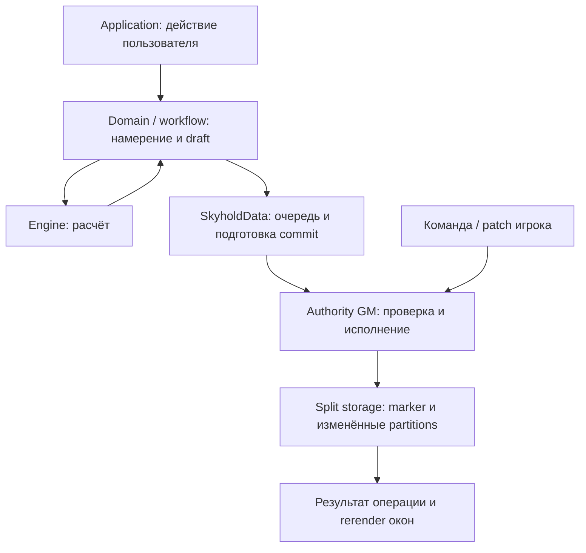

# Навигация по исходникам FBL Skyhold

Точка входа — [main.js](main.js): `init`, `ready`, публичный API, socket listener и открытие менеджера. Ограничения разработки заданы в [AGENTS.md](../AGENTS.md), действующие правила — в [docs/README.md](../docs/README.md).

## Карта владельцев поведения

| Область | Основные владельцы (`scripts/`) |
|---|---|
| Главное окно, вкладки, контекст | `apps/skyhold-app.js`, `apps/domains/ui-domain.js`, `apps/domains/building/rows-domain.js` |
| UI actions и события | `apps/events/action-router.js`, `apps/common/delegated-events.js`, `apps/domains/events/` |
| Rerender, закрытие, сохранение, фокус | `apps/common/{render-scheduler,pending-field-saves,save-status,window-frame,window-focus-keeper}.js` |
| Вторичные окна (ленивая загрузка) | `apps/lazy-apps.js`, `template-preload.js`, `lazy-styles.js` → класс нужного окна |
| Хранение, очередь и split-storage | `data/{store,commit-preparation,write-queue,split-storage,storage-commit}.js` |
| Команды игрока и authority-GM | `data/{socket,ship-socket,politics-socket,socket-auth}.js`, `apps/*-operation-executor.js` |
| Права записи игрока | `data/{holding-permissions,player-write-guard}.js`, правила профильных команд |
| Схема, нормализация, миграции | `data/schema/`, `data/normalizers.js`, `data/normalizers/`; явные миграции — `workflows/{buildings,economy}/` |
| Десятник и его фазы | `apps/domains/events/economy-events.js`, `apps/domains/finance/economy-domain.js`, `engines/tenday/` |
| Производство, еда, расходы, аграрка | `engines/economy/`, адаптеры — `apps/domains/finance/` |
| Рынок и перевозки | `engines/market/`, `data/market/`; `engines/transport/` (включая `router.js`), `workflows/transport/`, `data/transport/`; UI — `apps/{market-app,transport-app}.js` |
| Корабль и экипаж | `engines/ships/`, `apps/{ship-operation-executor,ships-context,ship-app}.js` |
| Труд, штат, QD и план | `data/{hybrid-labor,work-allocations,workforce-plan}.js`, `engines/workers/`, `apps/domains/workforce-planner.js` |
| Политика | `engines/politics/`, `data/politics-*.js`, `apps/politics-decision-context.js` |
| Массовый бой | `apps/mass-combat/{calculator,round-resolution,casualties,damage,supplies}.js`, `apps/mass-combat.js` |
| Foundry, календарь, отметки сцены | `integrations/{foundry-runtime,calendaria-bridge,scene-notes}.js` |
| Каталоги, контент и генераторы | `data/building-template-*`, `data/resources/`, `generators/`, `dev/` |

## Поток изменения данных



- Для операций игрока проверяйте обе стороны (UI и authority-GM): `operationId`, `revision` и receipt связывают повторы.
- `SkyholdData.view()` возвращает неизменяемый view, `get()` — копию, изменяемый `draft` доступен только в транзакции. UI-состояние вкладок/поиска/раскрытий в world data не пишется.
- **Композиция через `this`:** `SkyholdApp` и `SkyholdWorkflowService` собирают методы через `assignDomainGroup` (`composeDomainGroup` запрещает коллизии имён). Ищите определения по имени метода и проверяйте частичные test harnesses. Фаза дохода `_runBuildingIncomeForQd` принадлежит `FinanceEconomyDomain` (после производства, до питания/стройки).
- **Границы:** не смешивайте нормализацию, миграцию и repair; не удаляйте неисполненную работу при обрезке архивов; не путайте единицы (`QD`, `workUnits`, дни, ММ, `loadPoints`, отображаемые `З/С/М`); учитывайте всех потребителей `core/resources.js` и общих helpers; модель доверенного стола (ST-04) задана в [AGENTS.md](../AGENTS.md).

## Публичный API

После `ready` доступны `game.fblSkyhold.open()`, `rerender()`, `diagnostic()`, `uniqueBuildings` ([docs/unique-buildings-api.md](../docs/unique-buildings-api.md)) и `performance` ([docs/performance-baseline.md](../docs/performance-baseline.md)). Compatibility entry point для внешних макросов — `/modules/fbl-skyhold/scripts/data.js`:

```js
const { SkyholdData } = await import("/modules/fbl-skyhold/scripts/data.js");
await SkyholdData.transaction((draft, { skip }) => {
  const holding = draft.holdings.find(row => row.id === "example-holding");
  if (!holding) return skip(null);
  holding.overview.publicNotes = "Обновлено макросом";
});
```

Обычное значение возвращается после сохранения; `skip(value)` / `skipTransaction(value)` отменяет запись без мутации.

## Проверки и документация

- Профильные команды перечислены в [AGENTS.md](../AGENTS.md); `npm run check:all` прогоняет `lint` и все Node-проверки; `npm run perf:budget` запускается отдельно. В репозитории нет GitHub Actions — проверки запускаются локально.
- `npm run docs:check` сверяет локальные ссылки/якоря, полноту [docs/README.md](../docs/README.md), доступность ссылок внутри релизного состава (`scripts/dev/runtime-package-manifest.mjs`), соответствие двух генерируемых справочников (`build-building-catalog-reference.mjs`, `build-resource-catalog-reference.mjs`) и структурную достижимость дерева зданий (`building-development-reachability-check.mjs`).
